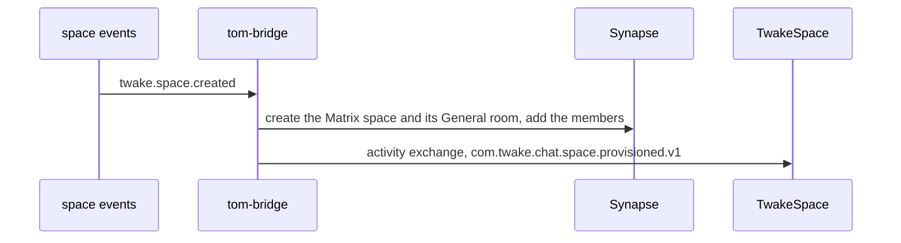

# Spaces

With a `spaces` block in its config, the bridge gives each TwakeSpace space a
Matrix space on the organization's homeserver, and keeps its members in line
with their roles in the space.



## Events

The bridge receives the space events on the queue of its `spaces` block. Their
routing key is `twake.space.<event>`:

* In SaaS, each organization has its own bridge, and the routing key ends with
  the organization id (`twake.space.<event>.<organization id>`). A bridge only
  receives the events of its organization.
* In a single installation, the bridge binds `twake.space.#` and receives every
  space event, without the organization id.

The bridge handles both forms the same way, and reacts to these events:

* `created` - creates the Matrix space, adds TwakeSpace's app service user and
  the members, then publishes `com.twake.chat.space.provisioned.v1` with the
  room id on the activity exchange. The event id is the same on every
  republish, so TwakeSpace takes the one of each nightly sync as a duplicate.
* `updated` - renames the Matrix space.
* `member.added`, `member.role.changed` - adds the member with the level of
  their role.
* `member.removed` - removes the member.
* `deleted` - removes every member at once. The Matrix space is deleted 30
  days later.
* `synced` - carries the whole space. The bridge handles it like `created`, and
  also renames the Matrix space and removes the members it no longer lists.
* `sync.completed` - ends a sync, with the ids of every space that still
  exists. A space the bridge provisioned before the sync and missing from this
  list was deleted while the bridge missed its `deleted` event: the bridge
  handles it as `deleted`.
* Group events are ignored: a group change also arrives as one member event per
  user it affects.

An event the bridge cannot read (no organization, space id, timestamp or
members, a member without `uuid`, a space id ending in `-general`) goes to the
dead-letter queue at once, without a retry.

`synced` and `sync.completed` arrive for every organization each night, and on
request.

With `syncRequestExchange` set, the bridge requests a sync when it starts and
knows no space yet, which is the case at its first deployment. It publishes
`twake.space.sync.requested` on that exchange once subscribed, so the `synced`
events find its queue. The spaces created before chat was deployed then get
their Matrix space without waiting for the night.

## The Matrix space

* It is unencrypted, so the bridge and TwakeSpace can read it.
* Its alias is `#twake-space-<space id>`, lowercased since space ids are
  case-insensitive. The bridge finds the room again from
  the space id through it, so a redelivered `created` reuses the room and
  announces it again. The bridge's registration must reserve these aliases:

  ```yaml
  namespaces:
    aliases:
      - exclusive: true
        regex: "#twake-space-.*:<domain>"
  ```

* The bridge bot is the only one at level 100, so only the bridge changes
  membership and settings, as it receives member events. The level of a member
  follows their role in the space:

  | Role in the space | Level | In the Matrix space and General |
  | --- | --- | --- |
  | admin | 75 | as an editor, and removes the messages of others |
  | editor | 50 | posts, votes in a poll, adds a channel |
  | viewer | 0 | reads, reacts and joins a call: no message or vote |

  A role the bridge does not know reads only, like a viewer. Adding a channel
  is `m.space.child` at 50, in the Matrix space only. The bridge does not keep
  the members of those channels in step with the space yet.
* TwakeSpace's user (`twakeSpaceUserId`, `@twakespace:<domain>` by default) is
  at 50. Its own app service registers that account: the bridge never creates
  it, and until it exists, logs at error level that it could not join it. The
  members still get the space.
* A member Synapse refuses (an id over 255 characters, a deactivated account)
  is left out and logged at error level, and the rest of the event goes ahead.
  A failure of the homeserver itself fails the event, which is retried.
* A member without a Matrix account gets one, named the way the SSO mapping
  names it (`localpartFrom`). For that person to sign in, the homeserver's OIDC
  provider needs `allow_existing_users: true`.

## General

Each Matrix space holds a General room, `#twake-space-<space id>-general`,
which the space's aliases rule above also covers.

* Only the members of the Matrix space can join it (`join_rule: restricted`),
  so someone removed from the space cannot come back to it. The room directory
  does not list it. A General created public by an earlier version gets the
  rule at its next `synced`.
* The bridge adds and removes the space's members, TwakeSpace's user included,
  in General as in the Matrix space, with the same levels.
* A sync only removes from General the members it removes from the Matrix
  space, so someone who joined a General on their own while it was public
  stays.
* Deleting the space makes General invite only, so no one can join it again,
  then removes everyone from it. General is deleted with the Matrix space.
* A Matrix space created without General gets it at its next `synced`.

## Ordering

Any number of pods consume the space queue, each up to 4 events at once. The
events of different spaces run together. Those of one space run one at a time,
on every pod:

* Each event takes the lock of its space before it reads anything: a queue in
  the pod, then a Postgres advisory lock (`pg_advisory_lock`) shared by the
  pods of one database.
* A pod that stops closes its connection, which releases its locks. RabbitMQ
  then delivers its unacknowledged events to another pod.

The lock is there because the events of a space change the same rooms, and
Matrix writes the power levels of a room whole: of two changes made at once,
one is lost. It also keeps a `created` event from adding members while the
`deleted` event of the same space removes them.

The lock does not order the events. They can reach the bridge out of order,
through retries or because two pods took them together. The bridge stores the
timestamp of the last change it applied to each member and to the space name,
and ignores an older event. The lock makes that check and the change one step.

Spaces need the database: with a `spaces` block, the bridge does not start
without it. An event the database cannot check or lock fails and is retried,
then ends in the dead-letter queue, and the nightly sync catches up. Applied
without its checks, it could undo a newer event or add members back to a
deleted space.

Each event holds one database connection for the time of its lock: 4 of the
10 connections of the pool at most, and the others serve the queries.

The space queue was declared with `x-single-active-consumer` by earlier
versions of this branch. RabbitMQ refuses to declare a queue again with other
arguments (`PRECONDITION_FAILED`), and the bridge then fails to start: delete
that queue once it is empty, and the bridge declares it again.

A member the SSO mapping cannot name (no username, or no usable email) is left
out and logged, and the rest of the event goes ahead.

A member event for a space without a Matrix space yet waits for the lock while
its `created` event runs. When that event has not arrived yet, the member event
fails and is retried, 3 times a second apart by default, then ends in the
dead-letter queue: the nightly sync adds the member.

Once a space is deleted, the bridge ignores its events, since its id is never
used again. Except a `created` or `synced` newer than the deletion: the space
still exists, so a `sync.completed` that missed it deleted it by mistake. The
bridge cancels the deletion, opens General to the members again and adds them
back.

## Deletion

The bridge keeps, in its database, the Matrix space of each space and when it
is due for deletion. Every hour, each pod deletes and purges the Matrix spaces
that are due, through the Synapse admin API. Two pods may delete the same room
in the same hour, which is harmless: a room already gone counts as deleted, and
a deletion that fails is tried again an hour later.

## Logs

At `LOG_LEVEL=debug`, the RabbitMQ client logs every message it receives and
publishes, here the name, email and username of every member of every space.
Do not leave it on in production.

<!-- vim: set ft=markdown fenc=utf-8 spell spl=en tw=80 cc=80 et ts=2: -->
